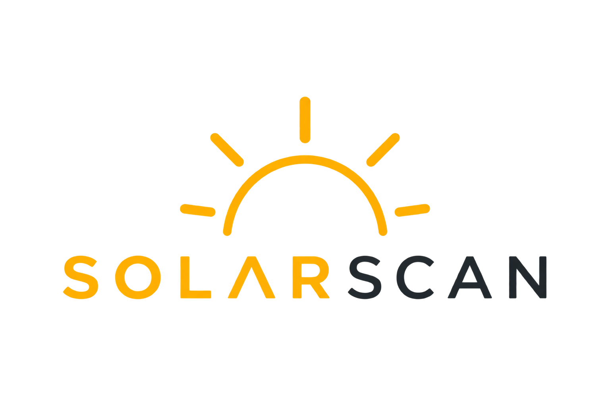

<div align="center">
  
  <h1>SolarScan 1.6.0 🛰️☀️</h1>
  <p><strong>Logiciel professionnel de détection de panneaux solaires par imagerie satellite pour la facturation de nettoyage.</strong></p>
</div>

---

## 📋 Présentation

**SolarScan** est une application desktop (Windows, macOS, Linux) pensée pour les professionnels du nettoyage de panneaux photovoltaïques. Grâce à l'imagerie satellite haute résolution de l'IGN et à une intelligence artificielle intégrée, l'application est capable de détecter automatiquement les panneaux solaires sur les toits et de générer instantanément des devis professionnels complets.

> ⚠️ **Couverture géographique : France uniquement** — L'imagerie haute résolution IGN Géoplateforme couvre exclusivement la France métropolitaine et les DOM-TOM.

---

## ✨ Fonctionnalités Principales

*   🗺️ **Navigation et Imagerie IGN Haute Résolution** : Visualisez n'importe quelle adresse en France grâce au fond de carte de l'IGN.
*   🔍 **Barre de Recherche Intelligente** : Entrez directement une adresse comme sur Google Maps pour y accéder en une fraction de seconde.
*   🤖 **Détection Automatique (IA)** : Scannez la zone visible ou dessinez manuellement une zone à analyser. L'algorithme détecte les panneaux, dessine leurs contours et calcule leur surface en $m^2$.
*   💶 **Tarification Intelligente par Paliers** : Configurez jusqu'à 4 paliers de facturation selon la surface (ex: 3,50€/m² jusqu'à 100m², 3,00€/m² jusqu'à 300m²...). L'application applique automatiquement le bon prix à chaque panneau.
*   📄 **Génération de Devis PDF Professionnels** : 
    *   Devis design et premium à l'image de votre société.
    *   **Géocodage inverse** : l'adresse du client est automatiquement trouvée grâce aux coordonnées GPS des panneaux.
    *   Aperçu satellite annoté inclus dans le devis.
    *   **Filigrane transparent** (votre logo) élégamment placé au centre du PDF pour prouver l'authenticité de vos devis.
*   📊 **Export CSV Compatible Excel FR** : Exportez la liste complète des détections avec un CSV dont le formatage est parfaitement adapté au marché français (séparateurs en point-virgule, virgules décimales, accents UTF-8 gérés).
*   🏢 **Personnalisation** : Importez votre propre logo, configurez le nom, l'adresse, le SIRET de votre société, et votre taux de TVA.
*   🕘 **Historique des devis** : chaque PDF généré est noté sur l'ordinateur (client, surface, montants). L'historique s'exporte en CSV.
*   🎯 **Seuil de confiance et fusion des doublons** : ignorez les détections trop incertaines, et fusionnez deux tracés du même toit (moins de 15 m).
*   🚗 **Feuille de route** : numéro de devis automatique, durée de validité réglable, et export PDF de la tournée du jour.

---

## 💻 Télécharger et installer (Windows et Mac)

Les installeurs officiels sont sur la [page des versions](https://github.com/Dontbyshai/SolarScan/releases).

### Windows

Téléchargez le fichier `.exe` (par exemple `Solar Scanner Setup 1.6.0.exe`), lancez-le, puis ouvrez **Solar Scanner** depuis le menu Démarrer.

### macOS

1. Téléchargez le fichier `.dmg`, ouvrez-le, et glissez **Solar Scanner** dans le dossier **Applications**.
2. Si macOS dit que l'application **n'est pas conforme**, faites un **clic droit** sur Solar Scanner dans Applications, choisissez **Ouvrir**, puis encore **Ouvrir**.
3. Si macOS dit que l'application est **endommagée**, n'allez pas à la corbeille. Ouvrez le **Terminal**, copiez cette commande, puis appuyez sur Entrée :

```bash
xattr -cr "/Applications/Solar Scanner.app"
```

Ensuite, refaites un **clic droit** sur l'application, puis **Ouvrir**.

Vous n'avez à faire cela qu'une seule fois, jusqu'à la prochaine installation.

Pourquoi ce message ? L'application n'est pas encore signée par Apple. Quand vous la téléchargez (par exemple avec Chrome), macOS colle une étiquette « vient d'Internet ». Sans signature Apple, cette étiquette fait croire que l'app est endommagée, alors qu'elle ne l'est pas. La commande `xattr` enlève seulement cette étiquette.

---

## 🚀 Installation & Lancement (développement)

L'application est divisée en deux parties : un backend (Python) pour le moteur de détection et l'accès réseau, et un frontend (Electron) pour l'interface utilisateur.

### 1. Prérequis
*   **Node.js** (v18.x LTS) & **npm** (v9.x)
*   **Python** (v3.10+)

### 2. Installation
Tout le code est dans le dossier `solar-scanner/`. Depuis la racine du dépôt :

```bash
# Interface (Electron)
cd solar-scanner/electron
npm install
cd ../..

# Moteur (Python)
cd solar-scanner/backend
python3 -m venv venv
source venv/bin/activate      # Sur macOS/Linux
# venv\Scripts\activate       # Sur Windows
pip install -r requirements.txt
cd ../..
```

### 3. Lancement
Electron démarre **tout seul** le moteur Python sur `127.0.0.1:8765`. Un seul terminal suffit :

```bash
cd solar-scanner/electron
npm start
```

Ne lancez pas `uvicorn` en même temps : le port 8765 serait déjà pris, et l'application refuserait de démarrer. Pour travailler sur le moteur seul, quittez d'abord SolarScan, puis :

```bash
cd solar-scanner/backend
source venv/bin/activate
python -m uvicorn main:app --host 127.0.0.1 --port 8765
```

### 4. Modèle IA (optionnel)
Sans poids YOLO, SolarScan utilise une heuristique de couleur (confiance plafonnée à 70 %). Pour le modèle :

```bash
cd solar-scanner/backend
source venv/bin/activate
python download_model.py
```

Le fichier `solar_detector.pt` est enregistré dans le dossier de données de l'utilisateur, pas dans le programme (qui est souvent en lecture seule une fois installé) :

*   macOS : `~/Library/Application Support/SolarScan`
*   Windows : `%APPDATA%\SolarScan`
*   Linux : `~/.config/SolarScan`

On y trouve aussi `settings.json`, `historique.json` et le cache des tuiles (`cache/tiles.db`). Le statut en haut à droite indique `IA prête (YOLO)` ou `IA prête (heuristique)`.

---

## 📖 Mode d'emploi

1. **Régler vos paramètres** : Cliquez sur l'engrenage (⚙) en haut à droite. Importez le logo de votre société et configurez vos grilles tarifaires.
2. **Trouver un client** : Utilisez la barre de recherche au centre pour taper l'adresse du client.
3. **Scanner** : Une fois sur le toit du client (zoomez bien fort pour la précision), cliquez sur le bouton bleu **"🔍 Scanner"**.
4. **Générer le devis** : Le menu de droite s'ouvre avec le total calculé. Cliquez sur **Export PDF**. L'adresse se remplit toute seule, vérifiez-la, et cliquez sur **Générer le PDF**.
5. C'est fait ! Votre dossier "Téléchargements" s'ouvrira automatiquement pour vous montrer le devis terminé.

---

## 🛠️ Architecture Technique

*   **Frontend** : HTML5, CSS3 Natif (Design System sur-mesure ultra-léger), JavaScript (Vanilla), Leaflet (Cartographie), Electron (Moteur desktop).
*   **Backend** : FastAPI (Python), OpenCV, Ultralytics (YOLOv8) si le modèle est téléchargé, OpenStreetMap Nominatim (géocodage) et OSRM (itinéraire), le tout uniquement en local sur `127.0.0.1`.
*   **Système d'exports** : `printToPDF` (Chromium Electron) générant les documents vectoriels, exports CSV formattés sur-mesure en UTF-8 BOM.

---

<div align="center">
  <p>© 2024–2026 SolarScan — Développé avec ❤️ par dontbyshai — Licence MIT</p>
</div>
